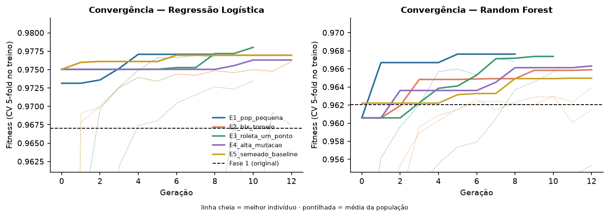

# Otimização de modelos de diagnóstico de câncer de mama — Fase 2

Projeto educacional que continua a Fase 1: os modelos de classificação de câncer de mama têm seus hiperparâmetros otimizados por um **algoritmo genético implementado do zero**, e uma **LLM pré-treinada** explica os resultados em linguagem natural para médicos. Inclui notebook de demonstração, API, interface web em Angular, monitoramento e escalabilidade automática.

## Integrantes

- Gabriel Wesley — RM376899
- Gustavo Leite — RM375733
- Luiz Fellipe — RM376854

## Vídeo de apresentação

https://youtu.be/tcyct9YdUrg

---

## Visão geral

Na Fase 1 foram treinados dois modelos para apoiar a triagem de câncer de mama com o dataset Breast Cancer Wisconsin, classificando cada registro como:

- `B` — benigno;
- `M` — maligno.

Os hiperparâmetros da Fase 1 foram escolhidos manualmente. Na Fase 2:

- um **algoritmo genético** busca os melhores hiperparâmetros da **Regressão Logística** e do **Random Forest**, incluindo o limiar de decisão;
- uma **LLM** recebe a previsão e os fatores que mais pesaram em cada paciente e escreve uma explicação para o médico;
- a qualidade dessas explicações é avaliada automaticamente e por um segundo modelo (LLM juiz).

O dataset e a divisão treino/teste são **os mesmos da Fase 1** (455 pacientes de treino e 114 de teste, 42 malignas), o que deixa a comparação "original × otimizado" justa. O algoritmo genético nunca vê o conjunto de teste.

> **Importante:** este projeto possui finalidade educacional e de apoio à triagem. Ele não substitui avaliação médica, exames clínicos, mamografia, biópsia ou decisões de profissionais da saúde.

---

## Objetivo

Otimizar os modelos de diagnóstico da Fase 1 com algoritmos genéticos e tornar seus resultados compreensíveis para a equipe médica com uma LLM.

O projeto contempla:

- codificação dos hiperparâmetros em genes;
- operadores de seleção, cruzamento e mutação;
- função fitness baseada em recall, F1 e ROC-AUC;
- pelo menos 3 experimentos com configurações diferentes do algoritmo genético (foram 5, mais uma busca aleatória de referência);
- comparação de desempenho entre os modelos originais e os otimizados;
- integração com uma LLM pré-treinada para explicações em linguagem natural;
- prompt engineering com 3 estratégias de prompt;
- avaliação da qualidade das interpretações geradas;
- API com escalabilidade automática, monitoramento e logs;
- interface web para demonstrar tudo de forma integrada;
- testes automatizados e relatório técnico.

---

## Resultados

Teste hold-out da Fase 1 (114 pacientes, 42 malignas):

| Modelo | Versão | Recall | F1 | ROC-AUC | Falsos negativos | Falsos positivos | Fitness CV 5×3 |
|---|---|---|---|---|---|---|---|
| Regressão Logística | Original (Fase 1) | 95,2% | 0,964 | 0,995 | 2 | 1 | 0,9659 ± 0,024 |
| Regressão Logística | **AG — E1 (selecionado)** | **97,6%** | 0,965 | 0,997 | **1** | 2 | 0,9703 ± 0,018 |
| Random Forest | Original (Fase 1) | 92,9% | 0,963 | 0,997 | 3 | 0 | 0,9516 ± 0,030 |
| Random Forest | AG — E4 | 95,2% | 0,976 | 0,998 | 2 | 0 | 0,9613 ± 0,026 |

O algoritmo genético melhorou os dois modelos, principalmente ajustando o limiar de decisão (0,26 na Regressão Logística, em vez de 0,5) e a regularização. O ganho é consistente, mas modesto: o modelo original já tinha ROC-AUC ≈ 0,99, e cada caso maligno no teste vale 2,4 pontos de recall.



Os detalhes estão no relatório técnico: [`reports/relatorio_tecnico_fase2.pdf`](reports/relatorio_tecnico_fase2.pdf).

---

## Como preparar o ambiente

```bash
git clone https://github.com/Gusta2150/desafio_tech_2.git
cd desafio_tech_2
python -m venv .venv
source .venv/bin/activate          # Windows: .venv\Scripts\activate
pip install -r requirements.txt    # ou: poetry install
```

Para usar a LLM real, copie `.env.example` para `.env` e preencha a chave do provedor:

| Provedor | Modelo padrão | Como obter |
|---|---|---|
| `groq` (recomendado) | GPT-OSS 120B (`openai/gpt-oss-120b`) | chave gratuita em console.groq.com → `GROQ_API_KEY=...` |
| `ollama` | LLaMA 3.1 8B (local) | instale o Ollama e rode `ollama pull llama3.1:8b` |
| `openai` | GPT-4o mini | `OPENAI_API_KEY=...` |
| `anthropic` | Claude Haiku | `ANTHROPIC_API_KEY=...` |
| `offline` | template | sem chave — usado em testes e como fallback |

> O arquivo `.env` nunca deve ser commitado. Sem chave, o projeto funciona com o provedor `offline`.

---

## Notebook de demonstração

O notebook principal está disponível em:

```text
notebooks/02_demo_fase2.ipynb
```

Ele mostra o projeto passo a passo, com cada chamada e cada retorno:

0. ambiente e provedor da LLM;
1. dados e ponto de partida (mesmo dataset e split da Fase 1, modelos originais);
2. algoritmo genético: codificação dos genes, operadores, função fitness e o AG rodando ao vivo;
3. experimentos: as 5 configurações, resultados, modelo escolhido e previsão de uma paciente;
4. LLM: contexto numérico, as 3 estratégias de prompt, resposta bruta e JSON, avaliação e juiz, básico × few-shot, pergunta livre, fallback, insights para a equipe clínica e a avaliação completa salva;
5. a API: chamadas e retornos;
6. escalabilidade, monitoramento (Prometheus e logs JSON) e testes.

Para executar o notebook:

```bash
jupyter notebook notebooks/02_demo_fase2.ipynb
```

> Os textos da LLM mudam a cada execução. Sem `.env`, o notebook usa o provedor `offline`.

---

## Algoritmo genético

Implementado do zero, em `src/ga/`:

- **Codificação:** cada indivíduo é um vetor entre 0 e 1; cada gene é decodificado em um hiperparâmetro real (com escala logarítmica quando necessário), inteiro ou categórico. O limiar de decisão também é um gene;
- **Seleção:** torneio, roleta e ranking;
- **Cruzamento:** uniforme, um ponto e BLX-α;
- **Mutação:** gaussiana e uniforme;
- **Motor:** elitismo, cache de indivíduos já avaliados e parada antecipada;
- **Fitness:** validação cruzada de 5 folds no treino, com 45% recall, 35% F1 e 20% ROC-AUC.

Os experimentos ficam em `configs/experiments.yaml` e são executados com:

```bash
python -m scripts.run_experiments                      # todos (≈ 40 min em 2 CPUs)
python -m scripts.run_experiments --models logistic_regression --experiments E1_pop_pequena
python -m scripts.run_experiments --quick              # versão mínima para testar o fluxo
```

O resultado vai para `reports/results/experiments.json`, `reports/runs/` e o melhor modelo para `models/`.

---

## Interpretação com LLM

Implementada em `src/llm/`:

- **Grounding:** a LLM não recebe a paciente crua. Ela recebe a probabilidade, o limiar, a faixa de risco e os 5 fatores que mais pesaram para a paciente, com as médias de benignos e malignos;
- **Prompt engineering:** 3 estratégias — básico, estruturado (persona, regras e saída em JSON) e few-shot;
- **Avaliação:** formato, fidelidade numérica, cobertura dos fatores, coerência com o modelo, segurança e legibilidade, além das notas de 1 a 5 do LLM juiz;
- **Fallback:** se a LLM falhar, o sistema responde com um template e indica isso explicitamente.

```bash
python -m scripts.demo --provider groq                       # demonstração ponta a ponta
python -m scripts.evaluate_llm --provider groq --judge groq  # avaliação das 3 estratégias
```

> Limites de taxa (429) e erros temporários são repetidos automaticamente, respeitando o `Retry-After` da API.

---

## Backend — API FastAPI

```bash
uvicorn src.api.main:app --port 8000
```

Documentação interativa em:

```text
http://localhost:8000/docs
```

| Rota | Descrição |
|---|---|
| `POST /predict` | Probabilidade de malignidade e orientação |
| `POST /interpret` | Explicação em linguagem natural (`estrategia`: basico, estruturado, few_shot) |
| `POST /ask` | Pergunta livre sobre um caso |
| `GET /report/performance` | Insights "original × otimizado" para a equipe clínica |
| `GET /experiments` · `GET /experiments/history` | Resultados do AG, convergência por geração e busca aleatória |
| `POST /optimize` · `GET /optimize/{id}` | Roda o AG em segundo plano e acompanha o progresso |
| `GET /samples` | Pacientes do teste com a previsão (filtros de erros, limiar, malignos e benignos) |
| `POST /llm/inspect` · `POST /llm/compare` | Tudo o que entra e sai da LLM; as 3 estratégias lado a lado |
| `GET /llm/evaluations` · `GET /llm/evaluations/{provider}` | Avaliações salvas da LLM |
| `GET /model` · `/health` · `/ready` · `/metrics` | Modelo em produção, sondas e métricas Prometheus |

---

## Frontend — Angular 16

O frontend disponibiliza uma interface web para demonstrar o algoritmo genético e a LLM de forma integrada, no mesmo estilo visual da Fase 1.

Tecnologias utilizadas:

- Angular 16;
- componentes standalone;
- TypeScript;
- `ng2-charts`;
- Chart.js.

### Como rodar o frontend

Pré-requisito: o backend deve estar em execução em:

```text
http://localhost:8000
```

A URL da API pode ser alterada no arquivo:

```text
frontend/src/environments/environment.ts
```

Execute os comandos:

```bash
cd frontend
npm install --legacy-peer-deps
npm start
```

Depois, abra no navegador:

```text
http://localhost:4201
```

> O parâmetro `--legacy-peer-deps` é utilizado devido a um possível conflito entre dependências peer do `ng2-charts` e Angular 16 no resolvedor estrito do npm.

### Fluxo da aplicação

No topo há um **seletor de provedor**: `offline` (padrão, sem chave nem cota) ou `groq` (LLM real). A LLM só é chamada quando alguém clica em um botão, e a chave fica apenas no `.env` da API — o navegador nunca a recebe.

#### 1. Visão geral — `/visao-geral`

- Modelo em produção;
- Comparação original × otimizado no teste.

#### 2. Algoritmo genético — `/algoritmo-genetico`

- Tabela dos experimentos;
- Convergência × busca aleatória e histórico por geração;
- Execução do AG ao vivo, com barra de progresso e gráfico atualizado a cada geração.

#### 3. Paciente + LLM — `/paciente`

- Escolha da paciente (com filtro de erros do modelo e casos perto do limiar);
- Previsão do modelo;
- Explicação gerada pela LLM;
- Pergunta livre sobre o caso.

#### 4. Inspetor da LLM — `/inspetor`

- Prompt de sistema e do usuário, contexto, resposta bruta e JSON;
- Notas automáticas, juiz, latência e tokens;
- Comparação das 3 estratégias de prompt lado a lado.

#### 5. Avaliação da LLM — `/avaliacao`

- Médias por critério e por estratégia;
- Gráficos, tabela por caso, exemplos e falhas.

#### 6. Relatório clínico — `/relatorio`

- Relatório "original × otimizado" para a equipe clínica.

### Build de produção

```bash
cd frontend
npm run build
```

---

## Escalabilidade e monitoramento

```bash
docker compose up --build --scale api=3          # API em :8080, Prometheus em :9090, Grafana em :3000
kubectl apply -f deploy/k8s/api.yaml             # Kubernetes com HPA (2–10 réplicas)
kubectl apply -f deploy/k8s/ga-job.yaml          # AG como Job em lote
```

- **Escalabilidade:** réplicas da API atrás do nginx no Docker Compose; HPA de 2 a 10 réplicas por CPU e memória no Kubernetes;
- **Métricas:** Prometheus por rota, previsões, chamadas à LLM (ok ou fallback) e fitness do AG, com o Grafana já conectado ao Prometheus;
- **Logs:** JSON estruturado, com `request_id` em cada requisição.

---

## Testes

```bash
pytest
```

São 75 testes automatizados cobrindo o algoritmo genético, modelos e fitness, LLM, avaliação e as rotas da API.

---

## Estrutura do projeto

```text
desafio_tech_2/
├── configs/
│   └── experiments.yaml                   # Configurações do AG e da fitness
├── data/
│   ├── data.csv                           # Mesmo dataset da Fase 1
│   └── breast_cancer_sample.csv
├── deploy/                                # nginx, Prometheus, Grafana e Kubernetes (HPA + Job)
├── docs/
│   └── arquitetura.md                     # Arquitetura e decisões
├── frontend/                              # Interface web Angular 16
│   └── src/
│       └── app/
│           ├── core/                      # Serviço da API, tipos e tema dos gráficos
│           ├── shared/                    # Componentes reutilizáveis
│           └── pages/                     # Visão geral, AG, paciente, inspetor, avaliação, relatório
├── models/
│   ├── best_model.joblib                  # Melhor modelo encontrado pelo AG
│   └── model_card.json
├── notebooks/
│   └── 02_demo_fase2.ipynb                # Notebook de demonstração
├── reports/
│   ├── figures/                           # Gráficos do relatório
│   ├── results/                           # experiments.json e avaliações da LLM
│   ├── runs/                              # Rastreamento por execução do AG
│   ├── relatorio_tecnico_fase2.md
│   ├── relatorio_tecnico_fase2.pdf        # Relatório técnico
│   ├── roteiro_video_fase2.md
│   └── roteiro_video_fase2.pdf            # Roteiro do vídeo
├── scripts/                               # Experimentos, avaliação da LLM, demo, figuras e relatório
├── src/
│   ├── ga/                                # Algoritmo genético
│   ├── llm/                               # Provedores, prompts, interpretação e avaliação
│   ├── api/                               # FastAPI e métricas Prometheus
│   └── data.py, models.py, fitness.py, ... # Dados, modelos, fitness, experimentos e monitoramento
├── tests/                                 # Testes automatizados (pytest)
├── .env.example
├── docker-compose.yml
├── Dockerfile
├── pyproject.toml
├── requirements.txt
└── README.md
```

---

## Onde está cada requisito

| Requisito | Onde |
|---|---|
| Codificação dos hiperparâmetros em genes | `src/ga/search_space.py`, `src/spaces.py` |
| Seleção, cruzamento e mutação | `src/ga/operators.py` |
| Função fitness (recall, F1, AUC) | `src/fitness.py` |
| ≥ 3 experimentos com configurações diferentes | `configs/experiments.yaml`, `src/experiments.py` |
| Comparação original × otimizado | `reports/results/experiments.json`, `reports/figures/` |
| LLM pré-treinada | `src/llm/providers.py` |
| Explicações em linguagem natural | `src/llm/interpreter.py`, `src/explain.py` |
| Prompt engineering | `src/llm/prompts.py` |
| Avaliação das interpretações | `src/llm/evaluation.py`, `scripts/evaluate_llm.py` |
| Escalabilidade automática | `docker-compose.yml`, `deploy/k8s/` |
| Monitoramento e logging | `src/monitoring.py`, `src/api/metrics.py`, `deploy/` |
| Arquitetura documentada | `docs/arquitetura.md` |
| Testes automatizados | `tests/` |
| Notebook de demonstração | `notebooks/02_demo_fase2.ipynb` |
| Aplicação web | `frontend/` |
| Relatório técnico | `reports/relatorio_tecnico_fase2.pdf` |
| Roteiro do vídeo | `reports/roteiro_video_fase2.pdf` |
| Vídeo de apresentação | https://youtu.be/tcyct9YdUrg |

---

## Relatórios

Os relatórios ficam no diretório:

```text
reports/
```

Todos os números do relatório técnico vêm dos arquivos de resultados. Para gerar de novo após novos experimentos:

```bash
python -m scripts.make_figures && python -m scripts.generate_report
```

---

## Aviso ético e clínico

Os resultados gerados pelo sistema representam uma análise computacional baseada em dados, modelos de Machine Learning e textos gerados por LLM.

Eles não devem ser utilizados isoladamente para determinar diagnósticos médicos. A interpretação clínica deve ser realizada exclusivamente por profissionais qualificados, considerando histórico médico, exames complementares e avaliação especializada.
